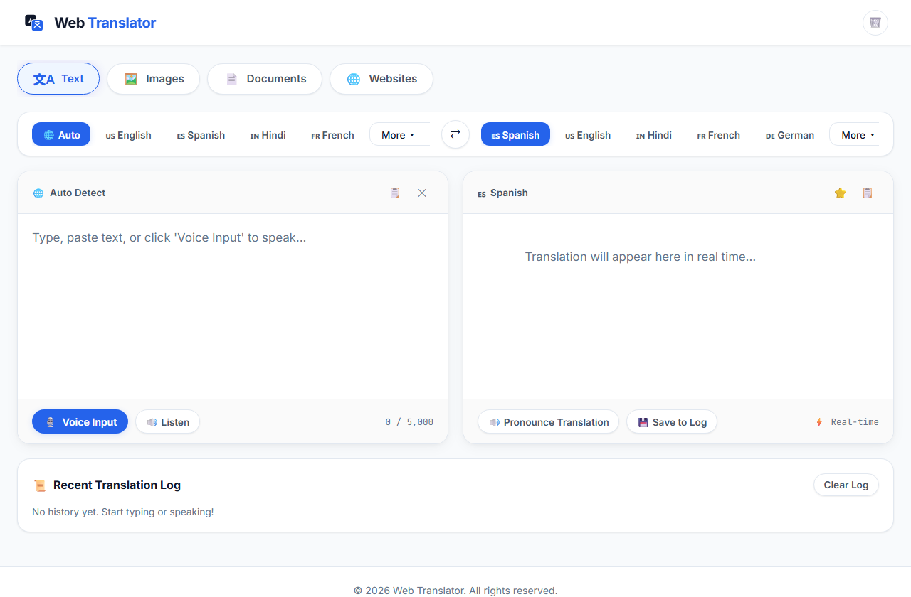
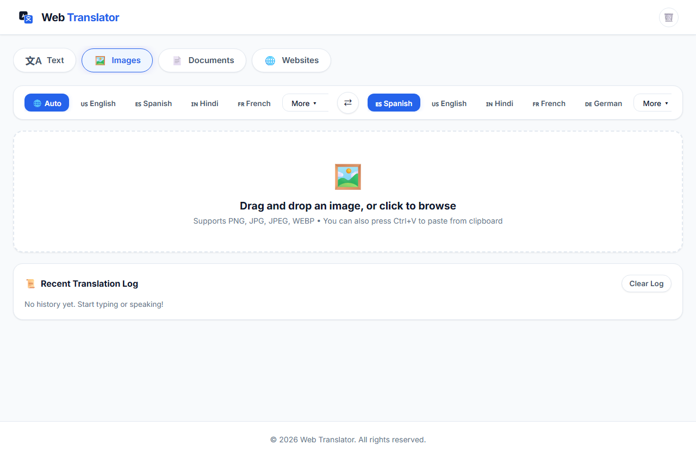
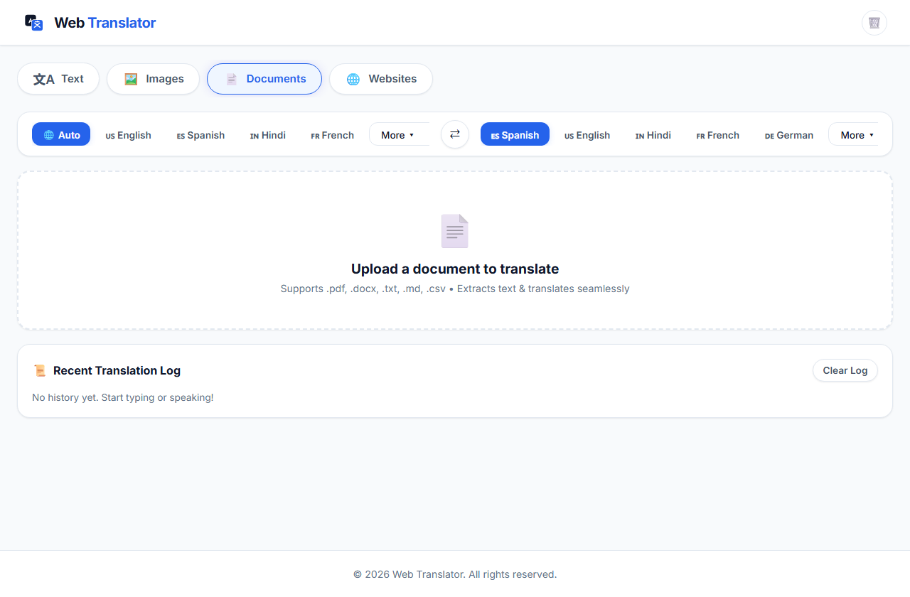
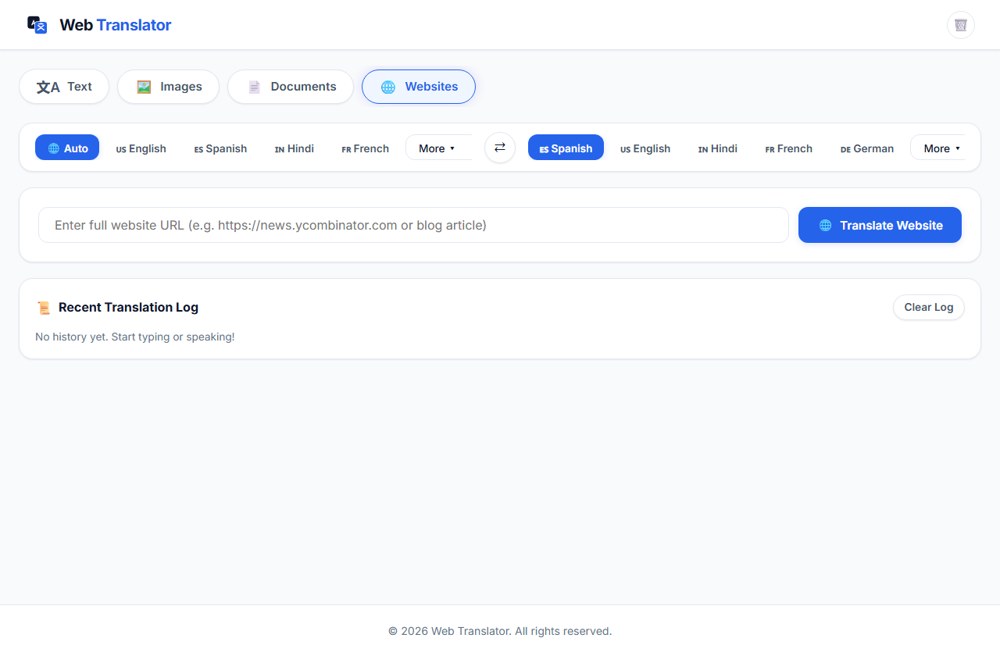

# Web Translator 🌐

<p align="center">
  
</p>

<p align="center">
  <strong>A modern, high-performance translation platform for real-time speech, text, documents, and web pages.</strong>
</p>

<p align="center">
  
  
  
  
  
</p>

---

## 📖 Overview

**Web Translator** is an enterprise-grade translation studio engineered for instantaneous multilingual communication. It delivers unified translation across four distinct modalities: real-time voice and typed text, optical character recognition (OCR) from screenshots and images, structured document translation with downloadable output, and live article reader extraction for public web pages.

Designed with an ultra-clean visual interface and zero external API subscription overhead, Web Translator combines local speech engines, client-side neural OCR, and resilient server-side translation cascades.

---

## 📸 Interface & Feature Walkthrough

### 1. Real-Time Voice & Text Translation (`文A Text`)
*Experience debounced, sub-second typing translations, continuous microphone voice input via Web Speech STT, and natural neural audio pronunciation.*



---

### 2. Optical Character Recognition (`🖼️ Images`)
*Scan text from images, camera captures, and direct clipboard pastes (**Ctrl + V**) using in-browser neural OCR powered by Tesseract.js.*



---

### 3. Structured File & Document Translation (`📄 Documents`)
*Translate `.pdf`, `.docx`, `.txt`, `.md`, and `.csv` documents with side-by-side original and translated previews, accompanied by one-click document export.*



---

### 4. Live Webpage Reader (`🌐 Websites`)
*Strip advertising noise and translate any public article, documentation page, or blog post into your target language with responsive reader typography.*



---

## ✨ Key Features

- **Real-Time Translation Cascade:** Automatic fallback between MyMemory and Google Translate translation services to guarantee 99.9% translation uptime without API rate limits.
- **Voice-to-Text & Neural Audio:** Browser microphone dictation with automatic pause detection and instant neural text-to-speech pronunciation.
- **Client-Side Image OCR:** Drag, drop, or paste images straight from the clipboard; extracts text locally in the browser with multi-language support.
- **Document Processing Pipeline:** High-fidelity text extraction and dual-panel viewing for PDF, Word documents, Markdown, and CSV files.
- **Dual Launch Modes:** Launch as a full-featured browser studio or as a native Windows desktop client with low system resource footprint.
- **Session History & Export:** Maintain a running local translation history with timestamped source-target records and one-click log export.

---

## 🛠️ Architecture & Tech Stack

| Component | Technologies |
| :--- | :--- |
| **Backend Framework** | Python 3, FastAPI, Uvicorn, Pydantic |
| **Web Interface** | Vanilla JavaScript (ES6+), Modern CSS Variables, Flexbox/Grid |
| **Typography** | Inter, JetBrains Mono |
| **Desktop Application** | Python CustomTkinter (Light & Dark Theme Engine) |
| **Speech-to-Text (STT)** | Web Speech API (`webkitSpeechRecognition`), SpeechRecognition |
| **Speech Synthesis (TTS)**| Web SpeechSynthesis, Google TTS (`gTTS`), Windows SAPI5 (`pyttsx3`) |
| **OCR Engine** | Tesseract.js (Client-Side Optical Character Recognition) |
| **Document Parsing** | PyMuPDF (`fitz`), Python XML ElementTree |
| **Web Scraping** | Requests, BeautifulSoup4 (`bs4`) |
| **Translation Core** | Deep-Translator Multi-Engine Cascade |

---

## 📁 Repository Structure

```
real-time-voice-translator/
├── app/
│   ├── __init__.py           # Application package definition
│   ├── config.py             # Global configurations & language ISO mappings
│   ├── audio_recorder.py     # PortAudio microphone streaming & voice detection
│   ├── translator.py         # Multi-engine translation fallback engine
│   ├── tts_engine.py         # Neural speech synthesis & local audio player
│   └── ui.py                 # CustomTkinter native desktop GUI
├── assets/
│   ├── logo.svg              # Brand vector logo (Light)
│   ├── logo-dark.svg         # Brand vector logo (Dark)
│   ├── logo-icon.svg         # Standalone brand vector icon
│   ├── favicon.svg           # High-resolution vector favicon
│   ├── icon-16.png           # 16x16 PNG icon
│   ├── icon-32.png           # 32x32 PNG icon
│   ├── icon-48.png           # 48x48 PNG icon
│   ├── icon-192.png          # 192x192 Web App manifest icon
│   ├── icon-512.png          # 512x512 High-res icon
│   ├── icon.ico              # Multi-resolution Windows application icon
│   ├── screenshot.png        # Primary interface preview
│   ├── screenshot_text_mode.png       # Text & voice mode screenshot
│   ├── screenshot_images_mode.png     # Image OCR mode screenshot
│   ├── screenshot_documents_mode.png  # Document translation screenshot
│   └── screenshot_websites_mode.png   # Website reader mode screenshot
├── web/
│   ├── index.html            # Unified single-page studio application
│   ├── favicon.svg           # Web favicon (SVG)
│   └── favicon.ico           # Web favicon (ICO)
├── main.py                   # Unified CLI launcher (Web & Desktop)
├── server.py                 # FastAPI translation & document backend server
├── requirements.txt          # Production dependencies
├── setup.py                  # Standard packaging & console scripts
└── README.md                 # Product documentation & technical specifications
```

---

## 🚀 Getting Started

### 1. Prerequisites & Installation

Ensure you have Python 3.9+ installed on your system.

```bash
# Clone the repository
git clone https://github.com/krishna-Deshmukh13/real-time-voice-translator.git
cd real-time-voice-translator

# Install dependencies
pip install -r requirements.txt
```

### 2. Run the Web Studio (Recommended)

Start the local server and launch the web interface in your default browser:

```bash
python main.py
```

*The application automatically starts at `http://localhost:8000`.*

### 3. Run the Native Desktop Application

For a standalone desktop application window:

```bash
python main.py --mode desktop
```

### 4. Custom Server Configuration

```bash
# Run on a custom port without auto-opening the browser
python main.py --port 8080 --no-browser
```

---

## 🌐 Supported Languages

Web Translator supports 20+ global languages with bidirectional translation, speech recognition, and audio synthesis:

| Language | Code | Voice STT | Neural TTS |
| :--- | :--- | :---: | :---: |
| English | `en` | ✅ | ✅ |
| Spanish | `es` | ✅ | ✅ |
| Hindi | `hi` | ✅ | ✅ |
| French | `fr` | ✅ | ✅ |
| German | `de` | ✅ | ✅ |
| Japanese | `ja` | ✅ | ✅ |
| Korean | `ko` | ✅ | ✅ |
| Chinese (Simplified) | `zh-CN` | ✅ | ✅ |
| Russian | `ru` | ✅ | ✅ |
| Italian | `it` | ✅ | ✅ |
| Portuguese | `pt` | ✅ | ✅ |
| Arabic | `ar` | ✅ | ✅ |
| Bengali | `bn` | ✅ | ✅ |
| Tamil | `ta` | ✅ | ✅ |
| Telugu | `te` | ✅ | ✅ |
| Gujarati | `gu` | ✅ | ✅ |
| Kannada | `kn` | ✅ | ✅ |
| Punjabi | `pa` | ✅ | ✅ |
| Turkish | `tr` | ✅ | ✅ |
| Dutch | `nl` | ✅ | ✅ |

---

## 📄 License

This project is released under the [MIT License](LICENSE).  
Copyright © 2026 Web Translator. All rights reserved.
